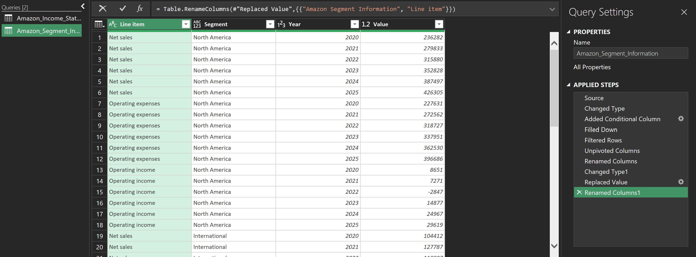
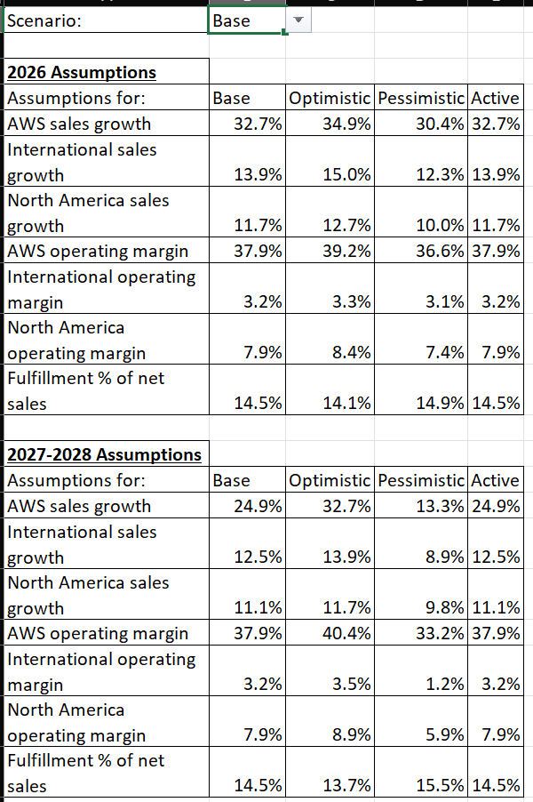
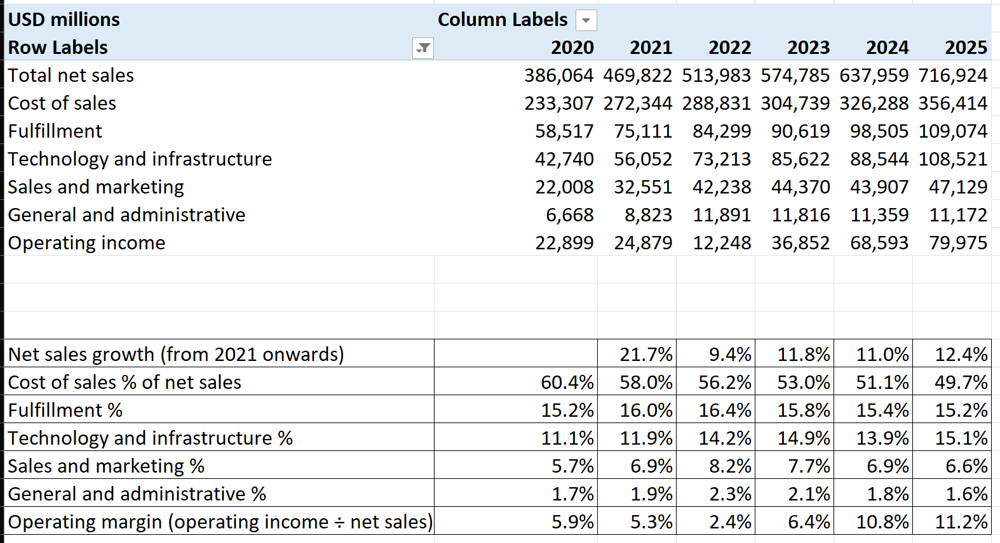
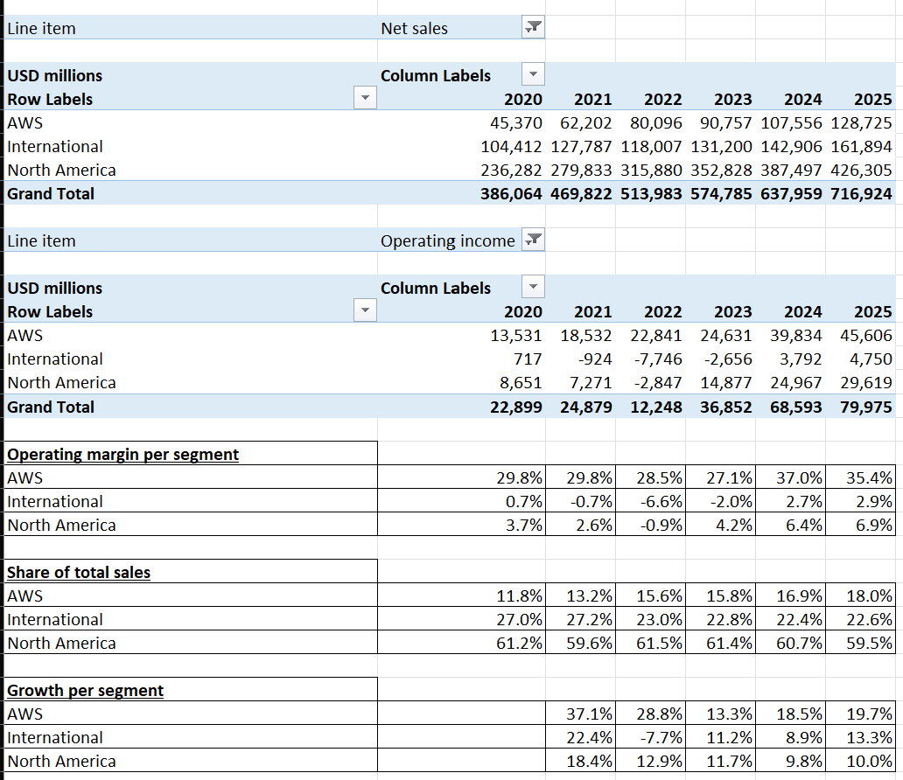
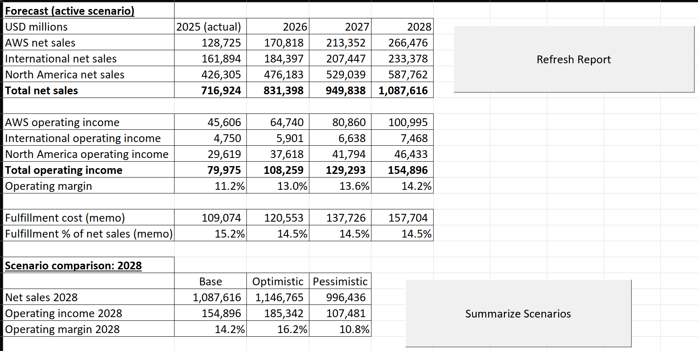

# Amazon Operating Model (Excel)

An Excel model of Amazon's income statement and segments from 2020 to 2025, with a forecast of net sales and operating income for 2026 to 2028 in 3 scenarios. It uses Power Query, pivot tables, formulas and VBA macros.

## Data

The data is from Amazon's 10-K reports for 2022 (covering 2020 to 2022) and 2025 (covering 2023 to 2025), which are available on SEC EDGAR. I used two tables from each report: the income statement and the segment information, which has net sales, operating expenses and operating income for North America, International and AWS. All values are in millions of USD.

In the 2022 report, "Technology and infrastructure" is called "Technology and content", so I relabeled it in order to combine both reports.

For the 2026 assumptions I also used Amazon's results release for Q2 2026, which includes the results for the first half of 2026 and the guidance for Q3 2026, as well as the results release for Q4 2025. The model was built in October 2026, before the Q3 2026 results came out.

## Method

### 2.1 Power Query

Both tables were entered with one row per line item and one column per year. In Power Query, the empty rows are removed and the year columns are unpivoted, so that every row has one line item, one year and one value. For the income statement this gives 114 rows (19 line items for 6 years).

The segment table needed a few more steps, since the segment names are rows of their own above their line items. A conditional column with the segment name is added and filled down, and the segment name rows are then removed. "Operating income (loss)" is also replaced with "Operating income" so that the name is the same for all segments. This gives 54 rows (3 line items for 3 segments and 6 years).

### 2.2 Pivot tables and ratios

The Analysis sheet has three pivot tables, one with the main lines of the income statement and two with net sales and operating income by segment. The grand totals of the segment pivot tables are the same as in the income statement, so both tables were entered correctly. Under the pivot tables are the ratios: net sales growth, each cost line as a share of net sales and the operating margin, as well as the operating margin, share of net sales and growth of each segment.

### 2.3 Forecast

For each segment, net sales are the previous year's net sales times (1 + growth), and operating income is net sales times the operating margin. Fulfillment is only a memo line (net sales times fulfillment as a share of net sales), since fulfillment costs are already included in the operating income of the segments.

The scenario is selected with a dropdown on the Assumptions sheet. An "Active" column then takes the assumptions of the selected scenario using `INDEX` and `MATCH`, and the Forecast sheet only refers to this column.

Amazon had already reported Q1 and Q2 2026 when the model was built, so for 2026 only the second half is forecast. Prime Day was in July in 2025 but in June in 2026, which makes growth in the first half of 2026 look higher than it is. This is corrected with the Q3 guidance, in which Amazon says that growth would be nearly 4 percentage points higher without Prime Day. In the base case, the second half grows at the corrected growth rate of the first half, and margins and fulfillment change compared with the year before by as much as they did in the first half. The optimistic and pessimistic cases use faster or slower growth and margin changes for the second half (for AWS, the growth rates of Q2 and Q1 2026).

For 2027 and 2028, growth in the base case moves halfway back towards the 2023 to 2025 average and margins stay at their 2026 level. The optimistic case keeps the 2026 growth rates and improves margins once more, while the pessimistic case uses the lowest growth of 2023 to 2025 and the average margins of those years. The exact rules (for example "halfway") are judgment calls and not estimates.

### 2.4 Macros

Each of the two macros has a button on the Forecast sheet. RefreshReport refreshes the Power Query tables and the pivot tables and reapplies the number formats, so new data only has to be entered in the raw tables. Background refresh is turned off for the queries, as otherwise the pivot tables could refresh before the new data is loaded. ScenarioSummary goes through all 3 scenarios and copies the 2028 net sales, operating income and margin of each into a comparison table, because the dropdown can only show one scenario at a time.

Both macros were recorded first and cleaned up afterwards, since the recorded code selected every cell before changing it. For ScenarioSummary, the recording also did not capture the dropdown changes, so these are now set directly in the code. The code is in the `.bas` files.

## Findings

### 3.1 Income statement

Net sales grew every year, from 386.1 billion USD in 2020 to 716.9 billion USD in 2025. The operating margin dropped from 5.9% in 2020 to 2.4% in 2022 and then rose to 11.2% in 2025. Most of the increase since 2022 (6.5 of 8.8 percentage points) comes from cost of sales, which fell from 56.2% to 49.7% of net sales. Technology and infrastructure went the other way, from 11.1% of net sales in 2020 to 15.1% in 2025. Both could partly be because AWS makes up more and more of net sales (see 3.2), as its server and data center costs are under technology and infrastructure and not under cost of sales.

### 3.2 Segments

AWS grew faster than Amazon as a whole in every year, and its share of net sales went from 11.8% in 2020 to 18.0% in 2025. Its margin was between 27.1% and 37.0%, while North America never got above 6.9% and International never above 2.9%. In 2025, AWS made 57.0% of Amazon's operating income with only 18.0% of its net sales.

In 2022, North America and International both made a loss, so AWS made more operating income (22.8 billion USD) than Amazon as a whole (12.2 billion USD). Since then, the margins of both have gone up every year.

### 3.3 Forecast

In the base case, net sales grow to 1.09 trillion USD in 2028, and operating income almost doubles from 80.0 billion USD in 2025 to 154.9 billion USD, a margin of 14.2%. Depending on the scenario, the margin in 2028 is between 10.8% and 16.2%. In the pessimistic case, operating income goes down in 2027 even though net sales still grow, because margins fall back to their 2023 to 2025 average. In all 3 scenarios, AWS makes around two thirds of operating income in 2028.

## Conclusions

From 3.1: The operating margin went up from 2.4% in 2022 to 11.2% in 2025, mostly due to lower cost of sales relative to net sales.

From 3.2: AWS is Amazon's smallest segment by net sales, but it made more than half of Amazon's operating income in every year from 2020 to 2025.

From 3.3: If the base case is right, the operating margin keeps rising to 14.2% in 2028, and in all 3 scenarios AWS would make around two thirds of the operating income.

The forecast only covers net sales and operating income by segment, and the assumptions are based on simple rules rather than a detailed analysis of each business. Exchange rates and one off items such as legal settlements are not modeled separately.

## Files

`amazon_operating_model.xlsm` is the model. Since GitHub cannot show Excel files, the screenshots above show the main sheets, and the macro code is in the `.bas` files. To use the dropdown and the macros, download the file and enable macros when Excel asks. If the macros are blocked, right click the file, go to Properties and tick Unblock.

